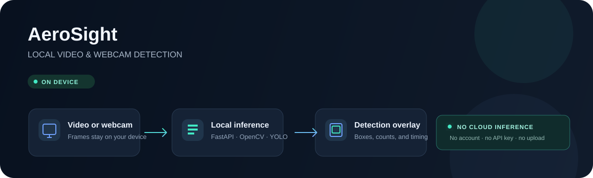

# AeroSight



**A local video and webcam workbench for person detection.** AeroSight keeps your footage and inference on your computer, with a browser UI backed by a local Python service. Roboflow is not part of the runtime.

> **Model status:** the included default is Ultralytics YOLO26n trained on COCO. It can detect people in general scenes, but it is not the fine-tuned UAV-Persons-Detection model from the original Roboflow project. Add compatible weights you own to run that model locally.

## What you can do

- Detect people in local MP4, MOV, and WebM videos.
- Run live inference from a connected webcam.
- Adjust the detection confidence and inference frame rate in the UI.
- Load a compatible local Ultralytics model file.
- Keep video frames, inference, and results on the same computer.

## How it works

The browser reads a selected video or webcam stream and sends frames over a WebSocket to the local FastAPI app. OpenCV decodes each frame, Ultralytics runs the model locally, and detections return to the UI for display. No account, API key, hosted inference service, or Roboflow connection is used.

## Run locally

Requires Python 3.10 or newer.

```powershell
python -m pip install -r requirements.txt
python app.py
```

Open [http://127.0.0.1:8000](http://127.0.0.1:8000). On first launch, Ultralytics downloads the small YOLO26n COCO weights if they are not already cached. You can also download compatible weights separately and point AeroSight to the file:

```powershell
$env:YOLO_MODEL = 'C:\path\to\best.pt'
python app.py
```

The model file stays local. For the aerial model from the original Roboflow project, export or obtain its weights and set `YOLO_MODEL` to that file; AeroSight does not fetch weights from Roboflow.

## Try a video

1. Start the app and open it in your browser.
2. Choose a local video or allow webcam access.
3. Set the confidence and frame rate, then select **Start detection**.

Video files are read by the browser and are not copied into the repository. The test clip used during development is from [Intel's sample videos](https://github.com/intel-iot-devkit/sample-videos); it is a test asset and is not included in this repository.

## Project structure

```text
app.py                         FastAPI server, WebSocket, and local inference
static/index.html              Browser interface for video and webcam
assets/aerosight-architecture.svg  README architecture illustration
```

## Licensing

The AeroSight application source is MIT licensed. The Ultralytics package is distributed under AGPL-3.0, and model weights have separate license terms. Review those terms before redistributing or using the software in a commercial product. Fine-tuned weights may also carry terms set by their owner or source.
